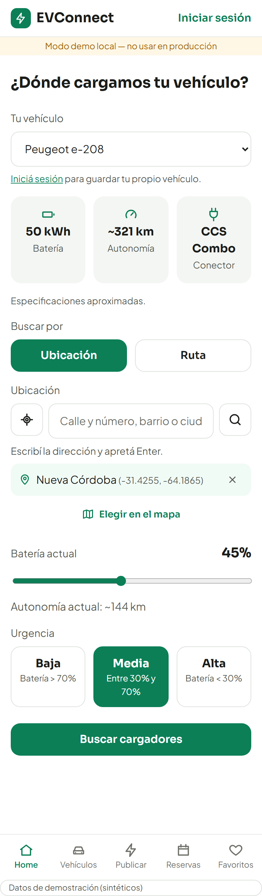

# EVConnect — Recomendación de puntos de carga para vehículos eléctricos

Demo funcional del Trabajo Final de Graduación (Ingeniería en Software). El sistema recomienda el punto de carga más
conveniente para un vehículo eléctrico sobre una red colaborativa de cargadores públicos y privados. Pondera la
ubicación o la ruta, la autonomía, la compatibilidad de conector, la disponibilidad, la espera, el tiempo de carga y el
costo. Tiene alcance nacional (Argentina); la zona piloto de los datos de demostración es Córdoba.

> **Datos de demostración:** todos los datos (cargadores, precios, ubicaciones, horarios, usuarios y reservas) son
> **sintéticos**. Las especificaciones de los vehículos son **aproximadas** y deben verificarse con las fichas oficiales.
> La interfaz lo indica con un aviso permanente.



## Inicio rápido

No hace falta ninguna cuenta externa: por defecto `AUTH_MODE=local`, `ROUTING_PROVIDER=offline` y
`GEOCODING_PROVIDER=nominatim` (búsqueda de direcciones con OpenStreetMap, gratuita y sin cuenta). La guía completa (requisitos, guion de demo y problemas frecuentes) está en
**[docs/RUN_LOCAL.md](docs/RUN_LOCAL.md)**.

**Opción A: todo en contenedores** (requiere Docker). La primera vez crea las tablas y carga los datos.

```bash
cp .env.example .env
docker compose up --build        # → http://localhost:3000
```

**Opción B: desarrollo con recarga en caliente** (requiere Node.js ≥ 22.12 y Docker para la base).

```bash
npm install
cp .env.example .env
npm run db:up && npm run db:migrate && npm run db:seed
npm run dev                      # API en http://localhost:3000 · web en http://localhost:5173
```

**Usuarios de demostración:** `usuario@demo.local` / `Usuario123!` y `admin@demo.local` / `Admin123!`. También se puede
buscar sin iniciar sesión.

## Qué incluye

- **Búsqueda** por ubicación (GPS, dirección o clic en el mapa) o por ruta (origen y destino), con un vehículo del catálogo, uno guardado o uno propio. La batería define la urgencia y la autonomía actual.
- **Recomendaciones** ordenadas, en lista y en mapa (Leaflet + OpenStreetMap), con "¿Por qué lo recomendamos?" (aporte de cada criterio al puntaje). Con Google Routes se dibuja el recorrido real por calles.
- **Viajes largos** (modo ruta): si con la batería no se llega al destino, cada opción trae su **plan de viaje** con las paradas siguientes y cuánto cargar en cada una. Si no hay forma de completar el viaje, se avisa y se indica dónde se corta. Para probarlo: Córdoba → Buenos Aires (cargadores sintéticos sobre la RN 9) y Córdoba → Mendoza (sin cargadores en el medio).
- **Reservas** sin solapamientos (409), dentro del horario del cargador. En cargadores privados quedan pendientes hasta que el dueño las acepta.
- **Red colaborativa:** publicar y administrar cargadores propios (ubicación, conector, potencia, precio y franjas horarias).
- **Fotos del catálogo** (Wikimedia Commons, con crédito) que el administrador puede reemplazar.
- **Mis vehículos**, favoritos y rutas guardadas. **Administración** de usuarios, cargadores y catálogo.
- **Autenticación** local (JWT, solo demo) o Amazon Cognito, detrás de una interfaz única. La autorización se verifica siempre en la API.

## Arquitectura

```
Navegador ─► web (React + Vite) ─► API (Express + TypeScript) ─► PostgreSQL 16 + PostGIS
                                     ├─ AuthProvider:    local (JWT HS256) | cognito (aws-jwt-verify)
                                     ├─ RoutingProvider: offline (Haversine × factor de circuito) | google (Routes API, con caché)
                                     └─ motor de recomendación (puro, sin E/S): api/src/engine
```

En producción hay **una sola imagen** (`api/Dockerfile`): la API sirve también el build de la web. El despliegue en
AWS (ECS Fargate, RDS, Cognito) está documentado en [docs/AWS_DEPLOY.md](docs/AWS_DEPLOY.md) y no hace falta para la demo.

## Motor de recomendación

1. **Preselección espacial (SQL):** hasta 8 cargadores activos y compatibles dentro de un radio de 20 km, o de un corredor de 5 km repartido en tramos a lo largo de la ruta.
2. **Filtros:** compatibilidad de conector, alcance con 10 % de margen de seguridad y disponibilidad en la ventana de carga. La espera máxima es de 2 h, sumando la espera por horario y por reservas.
3. **Estimaciones:** viaje, espera, energía hasta el objetivo de carga, tiempo de carga (potencia efectiva limitada por el vehículo) y costo.
4. **Plan de viaje** (modo ruta, cuando no se llega al destino sin cargar): Dijkstra por hora de llegada sobre los cargadores de todo el viaje; en cada parada se carga lo necesario para el tramo siguiente + 10 puntos ([D-045](docs/DECISIONES.md)).
5. **Puntaje:** suma ponderada (WSM) de distancia (o desvío), espera, carga y costo, con normalización min–max y rango mínimo por criterio. Los pesos dependen de la urgencia y se configuran en [`api/src/engine/config.ts`](api/src/engine/config.ts).

| Urgencia        | Distancia | Espera | Carga | Costo |
| --------------- | --------: | -----: | ----: | ----: |
| Alta (< 30 %)   |      0,45 |   0,25 |  0,20 |  0,10 |
| Media (30–70 %) |      0,30 |   0,20 |  0,25 |  0,25 |
| Baja (> 70 %)   |      0,15 |   0,15 |  0,20 |  0,50 |

**Simplificaciones** (documentadas a propósito): carga lineal sin curva de potencia, sin tráfico en tiempo real, ocupación conocida solo por reservas y tramos entre paradas estimados (línea recta × factor de circuito).

## Validación

```bash
npm run validate -- --scenarios 200 --seed 42
```

Compara el sistema contra una "selección manual simulada" (el cargador factible más cercano) y contra el óptimo por
fuerza bruta. Escribe [docs/validacion/resultados.md](docs/validacion/resultados.md) y `resultados.csv`. Es reproducible:
misma semilla, mismos archivos. Usa una base propia (`tfg_validacion`) y el proveedor offline por defecto.

Resultado con semilla 42 (200 escenarios, datos sintéticos):

- **Tiempo total:** 9,1 % menor que la línea base.
- **Espera:** 59,6 % menor.
- **Cercanía:** se cede un 12,1 %, como es esperable.
- **Costo:** sin una mejora consistente en el total; mejora con urgencia baja y empeora con urgencia alta.
- **Grado de optimalidad:** 97,9 %.

La sensibilidad a otras semillas está en [docs/DECISIONES.md](docs/DECISIONES.md) (D-037).

## Comandos

| Comando                     | Qué hace                                                                                                                                  |
| --------------------------- | ----------------------------------------------------------------------------------------------------------------------------------------- |
| `npm run db:up` / `db:down` | Levanta o apaga PostgreSQL + PostGIS en Docker                                                                                            |
| `npm run db:migrate`        | Aplica las migraciones (`-- --down` las revierte)                                                                                         |
| `npm run db:seed`           | Carga los datos de demostración (`-- --reset` limpia y vuelve a cargar)                                                                   |
| `npm run dev`               | API y web con recarga en caliente                                                                                                         |
| `npm test`                  | Pruebas del motor, la API (sobre una base de pruebas aparte) y la web. Requiere `npm run db:up`                                           |
| `npm run lint`              | ESLint, Prettier y verificación de tipos                                                                                                  |
| `npm run build`             | Compila la web y la API                                                                                                                   |
| `npm run validate`          | Validación del motor (ver arriba)                                                                                                         |
| `docker compose up --build` | Todo en contenedores en http://localhost:3000                                                                                             |
| `npm run capturas -w web`   | Recorre el guion de demo en Chromium y guarda capturas en `docs/capturas/` (con `npm run dev` corriendo; no corre si hay clave de Google) |

## Configuración

Todas las variables están en [`.env.example`](.env.example). Para usar servicios reales (opcional, ver
[docs/MANUAL_TASKS.md](docs/MANUAL_TASKS.md)):

- **Amazon Cognito:** `AUTH_MODE=cognito` y las variables `COGNITO_*` / `VITE_COGNITO_*`.
- **Google Routes API:** `GOOGLE_MAPS_API_KEY` y `ROUTING_PROVIDER=auto`. **Tiene costo por uso**: configurá antes alertas de presupuesto. La clave se usa solo en el backend.
- **Búsqueda de direcciones:** `GEOCODING_PROVIDER=nominatim` (por defecto; uso liviano según su política) o `static` (solo barrios y ciudades, sin servicios externos).

Nunca subas el `.env` al repositorio: está en `.gitignore`.

## Estructura

| Carpeta | Contenido                                                                                                                             |
| ------- | ------------------------------------------------------------------------------------------------------------------------------------- |
| `api/`  | API REST, motor (`src/engine`), proveedores de rutas (`src/routing`), validación (`src/validacion`), migraciones, seed y `Dockerfile` |
| `web/`  | Frontend: páginas, componentes, cliente de la API, sesión y estilos                                                                   |
| `docs/` | Especificación, plan, guías, decisiones, mockups, capturas, resultados de la validación y licencias                                   |

## Documentación

- [docs/SPEC.md](docs/SPEC.md): especificación (fuente de verdad).
- [docs/DECISIONES.md](docs/DECISIONES.md): desvíos y decisiones de implementación, incluidas las **diferencias con el informe**.
- [docs/RUN_LOCAL.md](docs/RUN_LOCAL.md): cómo ejecutar la demo. [docs/AWS_DEPLOY.md](docs/AWS_DEPLOY.md): despliegue en AWS.
- [docs/LICENCIAS.md](docs/LICENCIAS.md): licencias de terceros. Mapas © colaboradores de OpenStreetMap.
- [docs/capturas/](docs/capturas/): capturas de cada pantalla. [docs/validacion/](docs/validacion/): resultados de la validación.
